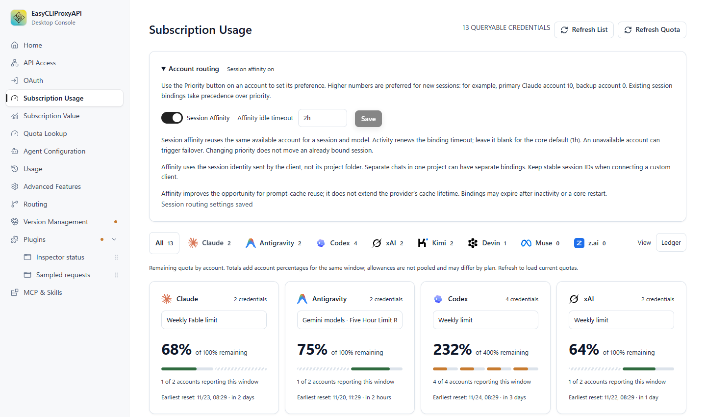
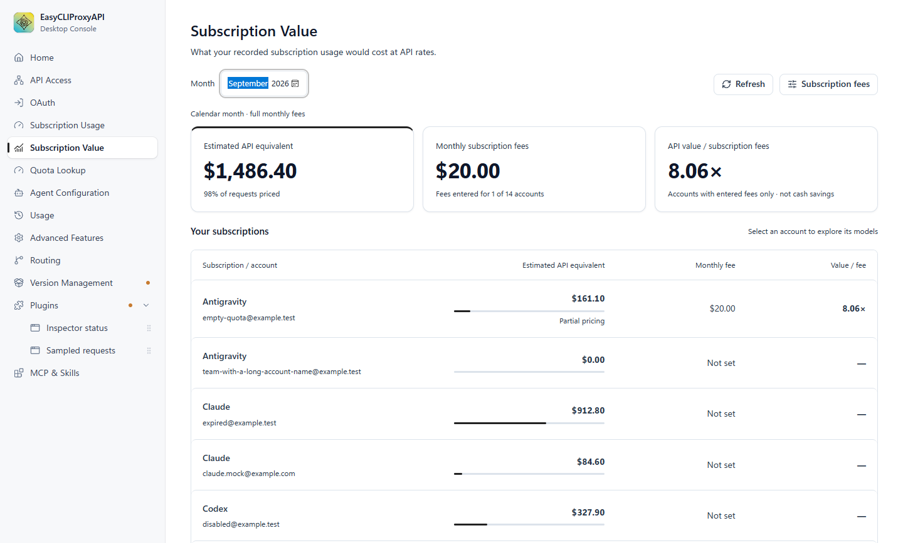

# EasyCLIProxyAPI Custom

An independently maintained Windows distribution of [EasyCLIProxyAPI](https://github.com/router-for-me/EasyCLIProxyAPI), the desktop console for [CLIProxyAPI](https://github.com/router-for-me/CLIProxyAPI). It tracks upstream releases closely and adds subscription tracking, account routing controls, durable storage, a Windows installer, and its own release and update channel.

**Current release: 1.3.117**, based on upstream desktop 0.3.117 with the official CLIProxyAPI core 8.0.78.

[Download the latest release](https://github.com/appliedi/EasyCLIProxyAPI-Custom/releases/latest) · [Changelog](CHANGELOG.md) · [Upstream merge guide](docs/upstream-merges.md) · [Contributing](CONTRIBUTING.md)

The upstream MIT license and attribution are preserved. Everything upstream offers (OAuth login, API providers, agent configuration, usage records, plugins, themes and more) is included; see the [upstream README](https://github.com/router-for-me/EasyCLIProxyAPI#readme) for that feature tour. This page covers what is different here.

## Install

Each release publishes two packages for Windows x64 and ARM64, each with a SHA-256 checksum:

| Package | Use it when |
| --- | --- |
| `EasyCLIProxyAPI-v<version>-Windows-<arch>-setup.exe` | You want a normal installed app with Start Menu and Installed Apps entries. |
| `EasyCLIProxyAPI-v<version>-Windows-<arch>.zip` | You want a portable folder you can move or copy. |

Both include the matching official core archive. The packages are not code-signed yet, so Windows SmartScreen may ask you to confirm the first launch.

## What this distribution adds

### Subscription Usage



A dedicated sidebar page for every OAuth subscription you have connected. Upstream's **Quota Lookup** page is still available separately.

- **Quota summaries by provider**, with each quota window shown on its own and a count of how many accounts actually reported it. Missing data is shown as unavailable, never as zero.
- **Ledger and card views** with search, sorting by name, remaining quota or next reset, and refresh limited to the accounts you can see.
- **Account priority.** Set an integer priority on any account; new sessions prefer higher numbers, so a primary account can take traffic before a backup.
- **Session affinity.** Keep a session on the same account and model so prompt caches get reused, with an adjustable idle timeout. Existing bindings take precedence over priority, and an unavailable account still fails over.

Priority and affinity are implemented by the official core. This app only edits the settings, and saving them leaves the rest of your routing configuration untouched.

### Subscription Value



See what your recorded subscription traffic would have cost at API prices, month by month.

- Estimates by account and model, a cumulative daily chart, and drill-down to input, output and cache tokens.
- Optional monthly fees per account, effective from the month you enter them. Changing a fee never rewrites earlier months. A blank fee means unknown; zero means free.
- Pricing coverage is shown openly. Requests without a known price are left out of the dollar figures and reported, not counted as free.
- API-key and unattributed traffic stays out of subscription totals, and history remains viewable while the core is offline.

Details are in [docs/subscription-value.md](docs/subscription-value.md).

### Storage and backups

Under **Advanced Features → Storage & backups** you can keep your data in a per-user folder (recommended), next to the app (portable), or in a custom location.

- The chosen location is remembered outside the release packages, so new versions extracted anywhere reopen the same usage history, fees, prices, settings and credentials.
- Moves, backups and restores are copied and verified at restart before anything writes to them. The SQLite databases are copied with the backup API so committed data is never lost, and the original folder is always kept.
- The data folder is locked to one running copy at a time, and the app refuses to start rather than silently creating an empty profile when the folder is missing or the configuration is invalid.

See [docs/data-storage.md](docs/data-storage.md).

### Windows installer

A per-user NSIS **Setup.exe** ships alongside the portable ZIP. It installs WebView2 when needed, offers to reuse an existing portable data folder, waits for the app to exit gracefully instead of force-closing it, and keeps usage, fees, settings and credentials on uninstall. In-app updates work for installed and portable copies alike. See [docs/windows-installer.md](docs/windows-installer.md).

### Our own update channel

- Desktop updates come only from this repository. The updater validates every manifest and rejects upstream's desktop releases, so a custom build is never replaced by a stock one.
- The Codex model catalog and the sensitive-word rule list are also served from this repository.
- Core updates still come from the official CLIProxyAPI releases, and the bundled core archive is checked against the official checksums.
- Upstream's optional background updates are included (**Version Management → Automatic updates**). They are off by default and use the same validated channel.

### Fixes beyond upstream

Each upstream merge is tested in full on Windows, and problems found there are fixed here rather than shipped. In 1.3.117 that included:

- Alias and agent YAML saves writing JSON one-liners into `config.yaml` (now normal YAML, comments kept).
- Antigravity usage double-counting on Windows because of path separators.
- ZCode keeping a deleted model as its default and writing reasoning settings that ZCode rejects.
- The system prompt proxy decompressing request bodies without a limit, and a crash when opening the ZCode prompt editor.
- Saving reverse proxy settings overwriting an unreadable `config.toml` with defaults.

New upstream screens are also brought in line with the shared UI controls, theme tokens and accessibility checks used across the app, and the Russian and Japanese translations are completed. The full list for each release is in the [changelog](CHANGELOG.md).

## Versioning

Versions mirror the upstream release they are built on: upstream `0.<minor>.<patch>` becomes `1.<minor>.<patch>`, so **1.3.117 is upstream 0.3.117**. The leading 1 marks this distribution and sorts above the older 0.4.x releases.

Fixes released between upstream versions add a build number: `1.3.117+1`, `1.3.117+2`, and so on. Windows shows these as 1.3.117.1 and 1.3.117.2. Release tags are immutable once published. See [versioning](docs/upstream-merges.md#versioning).

## Upgrading

- **From 0.4.x or later:** use the in-app update in **Version Management**. Your data stays where it is.
- **From the old custom 0.3.6 build:** that build still checks upstream's update feed, so upgrade by hand once. Close the app and stop its core, back up the folder, then extract the new ZIP over it, keeping `config.toml`, `oauth/` and `cpa-core/config.yaml`. Alternatively, run Setup.exe and point it at the old folder when asked.
- **Custom skills:** since 1.3.117 they are read from the `skills` folder next to the app. Skills in `$HOME/.easy-cli-proxy-api/skills` may need to be copied there.

## Building and contributing

```powershell
bun install
bun run check          # TypeScript
bun test               # frontend tests
cargo test --manifest-path src-tauri/Cargo.toml --bin cpa-gui -- --test-threads=1
.\build.ps1 -SkipCopy -BuildJobs 8   # Windows release build
.\build-installer.ps1 -SkipBuild     # Setup.exe from that build
```

Every change updates the [changelog](CHANGELOG.md). Upstream merges follow the [merge guide](docs/upstream-merges.md), which records each upstream commit, core version, conflict decision, and the customization map of files to protect. Validation reports for each merge are in `docs/upstream-*-validation.md`. See [CONTRIBUTING.md](CONTRIBUTING.md) for the rest.

## License

MIT, as in upstream. See [LICENSE](LICENSE).
